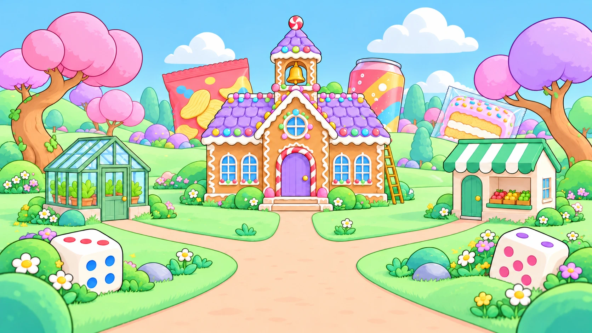

# Gutville

A university prototype that helps children in Years 4–6 explore food processing and ultra-processed foods through play.

**[Play Gutville](https://gutville-food-detectives.lipscombeholtcameron.chatgpt.site)** · [Run locally](docs/development.md) · [Learning bank](lib/curriculum.ts) · [Assessment method](docs/assessment-method.md)



## The project

Children race Pip the pear on a 49-square board, hopping between squares, climbing ladders and sliding down snakes. The usual turn-taking, exact-finish and overshoot rules apply. Answers never change movement or decide the winner. Label Lab and Mix & Match Market are coming-soon destinations.

Up to one food question follows each child roll. A round selects three objectives and works through opening predictions, supported practice and new application examples. The editable bank contains **six objectives, 24 matched scenario sets and 72 prompts**. Either player may win before every question is reached; missing observations remain missing.

The live app saves games centrally. Its protected researcher area shows matched before/after results, completion, repeat-play trends and optional enjoyment reactions, with two CSV export formats. First answers are preserved when practice questions are retried. Fictional demonstrations are separate from real paired summaries.

These are project-specific measures, **not a validated assessment instrument or evidence of causation**. Formal pupil research requires the university's applicable review and participant-information arrangements. Read the [assessment method](docs/assessment-method.md) before interpreting results.

## Technology

| Part | Technology |
| --- | --- |
| Interface | React 19, TypeScript, CSS, locally hosted DM Sans |
| Framework | Vinext, Vite and Next.js-compatible App Router conventions |
| Server | Cloudflare Workers and server routes |
| Storage | Cloudflare D1, Drizzle ORM and SQL migrations |
| Researcher access | Hosting-platform sign-in plus a server-side owner allowlist |
| Verification | Node test runner and TypeScript |
| GitHub project page | Static HTML/CSS in `site/` and GitHub Pages |

**The full game runs on the linked app host.** GitHub Pages hosts the project introduction. No participant records, local databases, credentials, presentation files or original deployment identity are included in this repository.

## Local development

Use Node.js **22.13.0 or newer** and npm. See [development.md](docs/development.md) for full setup, local D1 migration, preview and researcher configuration.

```sh
npm ci
npm run build
```

Run the game and analytics checks without installing the application's dependency tree:

```sh
npm test
```

All **16 tests passed on 16 November 2026** for this source export. Historical database/HTTP verification and remaining human evaluation are described in [validation.md](docs/validation.md).

The export omits the original Site ID. A separate game deployment needs its own hosting registration, database and researcher identity. Pushing to this repository does not update the existing live game.

## Explore the source

- [Editable curriculum](lib/curriculum.ts) and [scientific sources](docs/curriculum.md).
- [Game sequencing](lib/game.ts), [board rules](lib/board.ts) and [counter animation](components/board.tsx).
- [Analytics and CSV exports](lib/analytics.ts), [backend notes](docs/backend.md) and [assessment method](docs/assessment-method.md).
- [Project introduction](site/index.html) and [GitHub publication instructions](docs/github-publication.md).

## AI assistance and attribution

The project was developed iteratively with ChatGPT/Codex assistance for implementation, learning-content drafts, wording, testing and visual development. The town illustration is AI-generated; the app also uses authored vector artwork. This does not imply independent scientific, accessibility or educational validation.

Scientific references and their limitations are listed in [curriculum.md](docs/curriculum.md). Third-party licence notices for fonts, vendored tooling and styles are retained. Imperial College London branding identifies the university context and does not imply institutional endorsement. No project-wide reuse licence has been selected.
